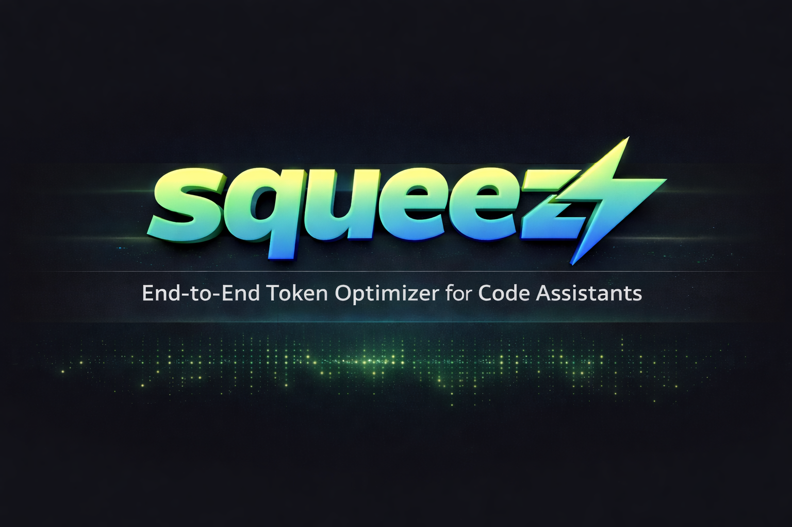

<p align="center">
  
</p>

# squeez

[](https://github.com/claudioemmanuel/squeez/actions/workflows/ci.yml)
[](https://www.npmjs.com/package/squeez)
[](https://crates.io/crates/squeez)
[](LICENSE)
[](CONTRIBUTING.md#license--contributor-sign-off)
[](CHANGELOG.md)

**squeez decides what tool output reaches your AI coding agent's context — and shows you what that saved.**

It sits in the hooks of seven agent CLIs (Claude Code, GitHub Copilot CLI, OpenCode, Gemini CLI, OpenAI Codex CLI, Pi, Hermes) and compresses command output, re-reads, screenshots and repeated results before the model reads them. Compression is **reversible** (anything dropped is one `squeez_retrieve` away), **refuses net-loss rewrites**, and fails open. One static Rust binary, zero runtime dependencies.

```text
$ squeez receipt
squeez receipt — last 7 day(s)
  sessions          27 (9951 min)
  tokens avoided    323,964  (squeez chars/4 estimate)
  cost avoided      ≥ $1.30  at claude-opus-5-5 input $4.00/MTok (floor: cache re-reads not counted)
  context avoided   0.3 × 1000K-token windows
```

---

## Install

```bash
curl -fsSL https://raw.githubusercontent.com/claudioemmanuel/squeez/main/install.sh | sh   # recommended
npm install -g squeez        # or: npx squeez — pre-built binary, Node ≥ 16
cargo install squeez         # build from source, Rust stable
```

Each puts the binary at `~/.claude/squeez/bin/squeez` and runs `squeez setup`, which registers the hooks in every host CLI it detects. Restart your CLI afterwards. Windows needs [Git Bash](https://git-scm.com/downloads).

```bash
squeez setup --host=claude-code,codex   # register only these hosts (or SQUEEZ_HOSTS=…)
squeez uninstall [--host=<slug>]        # remove hooks; sessions and config.ini are kept
squeez update [--check]                 # self-update, SHA256-verified
squeez doctor                           # health check: hooks, registration, config, host contract
```

| Host | Bash | Read/Grep limits | Session memory | Notes |
|---|---|---|---|---|
| **Claude Code** | ✅ wrap | ✅ hard | ✅ | Output rewrite for Read/Grep/MCP, sub-agent metering, compaction recovery |
| **Copilot CLI** | ✅ wrap | ✅ hard | ✅ | Memory in `~/.copilot/copilot-instructions.md` |
| **OpenCode** | ✅ wrap | ✅ hard | ✅ | Plugin `~/.config/opencode/plugins/squeez.js`; MCP calls skip hooks (sst/opencode#2319) |
| **Gemini CLI** | ✅ wrap | 🟡 soft (GEMINI.md) | ✅ | Rewrite schema pending ([gemini-cli#25629](https://github.com/google-gemini/gemini-cli/issues/25629)) |
| **Codex CLI** | ✅ wrap | 🟡 soft (AGENTS.md) | ✅ | `read_file`/`grep` hooks pending ([codex#18491](https://github.com/openai/codex/issues/18491)) |
| **Pi** | ✅ wrap | ✅ hard | ✅ via skill | Extension `~/.pi/agent/extensions/squeez/` |
| **Hermes** | ✅ output hook | ❌ | ✅ | Opt-in: `hermes plugins enable squeez-fallback` |

---

## What it does

**Compresses what the agent reads**

- **Bash output** — every safe command runs through `squeez wrap`: a handler for 60+ programs (git, cargo, npm, pytest, jest, tsc, kubectl, terraform, …), 41 shipped filter rules, then smart-filter → dedup → log-template → relevance truncation. Risky commands (`rm -rf`, `git push --force`, …) run unwrapped under the host's own permission rules.
- **Re-reads** — a file read again unchanged collapses to `identical to Read #N`; read again after a small edit, it comes back as one diff hunk against the earlier read.
- **Screenshots** — images in MCP results with a long edge above 1024 px are downscaled with `sips`/ImageMagick (image tokens scale with pixel area); the full-size file is kept and named.
- **Repeats** — exact and fuzzy (MinHash ≥ 0.85) dedup across recent calls; repeated skill injections and identical images collapse session-long.
- **Huge outputs** — over 500 lines become a ≤40-line summary that still carries every exact id (SHAs, UUIDs, tickets, versions).

**Never loses what matters**

- **Reversible** — dropped content is stashed; `squeez_retrieve` expands it, `squeez_stash_search` finds it by meaning.
- **Learns from its mistakes** — when the model retrieves a program's originals often, that program is compressed one level lighter.
- **Guards** — net-win gate (no rewrite that costs more than it saves), anchor-preservation guard, secret-looking content is never stashed.
- **Fails open and speaks up** — any error means raw output; a host that changes its hook format is reported (`[squeez: host payload changed …]`, `squeez doctor`) instead of failing silently.

**Watches the budget**

- **Adaptive intensity** — Full below 80% of the window, Ultra above, from the context size measured in the host transcript (200K and 1M windows).
- **Budget advisor** — in a nearly full window, a call to a program that has been expensive before gets a one-line advisory naming both numbers.
- **Sub-agents** — real token cost measured from the transcript; a ceiling on concurrent spawns.
- **Per-session state** — concurrent sessions keep separate counters and dedup history.

**Shows the result**

- `squeez receipt` — tokens avoided, priced at the model the session ran on, as text or a shareable table.
- `squeez export` — content-free metrics as JSON or OTLP for a team's own backend.
- **Session memory** — each session starts with the previous sessions *in the same repository*, from any installed host.

---

## Commands

```bash
squeez receipt [--days N] [--model ID] [--format md]   # what squeez saved, in tokens, dollars and windows
squeez export [--format json|otlp] [--days N] [--out F] [--endpoint http://…/v1/metrics] [--no-handlers]
squeez discover                                       # programs squeez compresses poorly, by tokens emitted
squeez discover --suggest "<cmd>" [-] [--apply]       # propose a filter rule from that program's real output
squeez filters add <dir|file.ini|git-url> | list | remove <name>   # install shareable rule packs
squeez filter-test                                    # run every filter rule's inline tests
squeez gateway-sim [--days N] [transcript.jsonl…]     # what an API-level gateway would add (read-only)
squeez doctor | prune | calibrate                     # health check · clean the stash · tune config
squeez config get|set|list|reset|path                 # or /squeez in natural language inside the session
squeez wrap <cmd> · squeez filter <hint>              # compress a command / stdin by hand
squeez compress-md [--ultra] [--lang pt] <file>       # compress CLAUDE.md / AGENTS.md prose
squeez benchmark [--json] [--efficiency-proof]        # reproduce the numbers below
squeez mcp                                            # MCP server: 18 tools over stdio
```

Prefix a command with `--no-squeez` to run it untouched.

A wrapped command prints one header line:

```text
# squeez [git log] 2692→289 tokens (-89%) 0.2ms [adaptive: Full]
```

### Filter rules

The DSL covers what no handler does. Layers, most specific first: `./.squeez/filters.ini` (project) > `~/.claude/squeez/filters.ini` (user) > installed packs (`filters.d/`) > the shipped pack. Every rule carries `test_input`/`test_expect`; a pack installs only when all its tests pass.

```ini
[filter "mix compile"]
strip_lines_containing = "Compiling "
test_input  = "Compiling 3 files (.ex)\nerror: undefined function foo/0"
test_expect = "error: undefined function foo/0"
```

`squeez discover --suggest "bazel test"` writes such a rule for you from stashed output (or `bazel test 2>&1 | squeez discover --suggest "bazel test" -`), measured on the samples and appended only with `--apply`.

### MCP tools

`claude mcp add squeez -- ~/.claude/squeez/bin/squeez mcp` exposes 18 read-only tools: `squeez_retrieve` and `squeez_stash_search` (expand or find a stashed original), session memory (`squeez_recent_calls`, `squeez_seen_files`, `squeez_seen_errors`, `squeez_seen_error_details`, `squeez_prior_summaries`, `squeez_search_history`, `squeez_file_history`, `squeez_session_detail`), accounting (`squeez_session_summary`, `squeez_session_stats`, `squeez_session_efficiency`, `squeez_context_pressure`, `squeez_agent_costs`, `squeez_handler_stats`, `squeez_enterprise_savings`) and `squeez_protocol`, which teaches the model squeez's markers.

---

## Configuration

`~/.claude/squeez/config.ini` (other hosts: their own squeez dir; `squeez config path` prints it; `SQUEEZ_DIR` overrides). Every key is optional.

```ini
# Compression
max_lines                = 200      # generic truncation limit
bypass                   = docker exec, psql, mysql, ssh   # never wrapped
wrap_bash                = true
builtin_filters          = true     # the 41-rule shipped pack
image_max_edge           = 1024     # downscale MCP images above this long edge (0 = off)
read_diff_enabled        = true     # re-read after a small edit → one diff hunk
retrieve_soften_rate     = 0.2      # retrieves per call that make a program compress lighter (0 = off)

# Context and budget
adaptive_intensity       = true     # Full < 80% of the window, Ultra above
context_window_tokens    = 0        # 0 = detect from the transcript
budget_advice_pct        = 0.7      # advise before expensive calls above this share used (0 = off)
budget_advice_min_tokens = 1500

# Output and memory
persona                  = ultra    # off | lite | full | ultra — terse prompt persona
focus                    = off      # off | adhd — action-first output structure
auto_compress_md         = true
buddy                    = true     # the status-line companion
lang                     = en       # en | pt
memory_retention_days    = 30
flag_force               = env      # env | full | off — formatting env vars (NO_COLOR, AI_AGENT, …)
```

All keys and defaults: [`src/config.rs`](src/config.rs).

---

## Benchmarks

<!-- BENCHMARK:START -->
Measured on macOS (Apple Silicon). Token count = `chars / 4` (matches Claude's ~4 chars/token). Run `squeez benchmark` to reproduce.

### Per-scenario results — 46 scenarios × 5 iterations

| Scenario | Before | After | Reduction | Latency |
|----------|--------|-------|-----------|---------|
| `curl_json` | 18,904 tk | 36 tk | **-100%** | 1.1 ms |
| `az_json` | 23,479 tk | 74 tk | **-100%** | 583 µs |
| `summarize_huge` | 82,257 tk | 467 tk | **-99%** | 88.3 ms |
| `xcode_build` | 1,881 tk | 17 tk | **-99%** | 290 µs |
| `go_test_ndjson_failures` | 7,176 tk | 106 tk | **-99%** | 1.1 ms |
| `read_reread_distant` | 717 tk | 17 tk | **-98%** | 10.1 ms |
| `rsync_transfer` | 912 tk | 26 tk | **-97%** | 204 µs |
| `repetitive_output` | 4,692 tk | 134 tk | **-97%** | 403 µs |
| `pytest_failures` | 3,402 tk | 108 tk | **-97%** | 300 µs |
| `jest_json_failures` | 5,643 tk | 218 tk | **-96%** | 794 µs |
| `systemctl_status` | 732 tk | 41 tk | **-94%** | 192 µs |
| `ps_aux` | 40,373 tk | 2,338 tk | **-94%** | 1.0 ms |
| `cargo_test_failures` | 1,934 tk | 157 tk | **-92%** | 234 µs |
| `git_log_200` | 2,692 tk | 275 tk | **-90%** | 399 µs |
| `tsc_errors` | 731 tk | 101 tk | **-86%** | 231 µs |
| `eslint_json_failures` | 1,553 tk | 233 tk | **-85%** | 402 µs |
| `pip_install` | 407 tk | 62 tk | **-85%** | 192 µs |
| `high_context_adaptive` | 4,418 tk | 729 tk | **-84%** | 1.6 ms |
| `cargo_build_noisy` | 2,106 tk | 439 tk | **-79%** | 505 µs |
| `bundle_install` | 121 tk | 28 tk | **-77%** | 175 µs |
| `docker_logs` | 665 tk | 181 tk | **-73%** | 232 µs |
| `curl_html_response` | 2,181 tk | 626 tk | **-71%** | 236 µs |
| `git_status` | 50 tk | 16 tk | **-68%** | 172 µs |
| `ruff_json_failures` | 1,261 tk | 494 tk | **-61%** | 371 µs |
| `verbose_app_log` | 4,957 tk | 1,978 tk | **-60%** | 821 µs |
| `npm_install` | 524 tk | 218 tk | **-58%** | 222 µs |
| `crosscall_redundancy_3x` | 486 tk | 222 tk | **-54%** | 52.6 ms |
| `ls_la` | 1,782 tk | 872 tk | **-51%** | 241 µs |
| `mypy_errors` | 650 tk | 349 tk | **-46%** | 184 µs |
| `shellcheck_run` | 335 tk | 187 tk | **-44%** | 169 µs |
| `agent_directory_output` | 3,348 tk | 1,937 tk | **-42%** | 938 µs |
| `env_dump` | 441 tk | 287 tk | **-35%** | 189 µs |
| `agent_heavy` | 2,306 tk | 1,514 tk | **-34%** | 689 µs |
| `git_copilot` | 640 tk | 421 tk | **-34%** | 281 µs |
| `find_deep` | 424 tk | 279 tk | **-34%** | 197 µs |
| `adversarial_tiny_output` | 4 tk | 3 tk | **-25%** | 160 µs |
| `md_prose` | 187 tk | 142 tk | **-24%** | 120 µs |
| `md_claude_md` | 316 tk | 270 tk | **-15%** | 231 µs |
| `claude_md_overhead` | 717 tk | 635 tk | **-11%** | 168 µs |
| `next_build_output` | 902 tk | 884 tk | **-2%** | 233 µs |
| `git_diff` | 502 tk | 497 tk | **-1%** | 213 µs |
| `jest_failures` | 451 tk | 448 tk | **-1%** | 216 µs |
| `state_first_simulation` | 182 tk | 181 tk | **-1%** | 159 µs |
| `kubectl_pods` | 1,513 tk | 1,513 tk | **-0%** | 213 µs |
| `adversarial_dense_json` | 485 tk | 485 tk | **-0%** | 173 µs |
| `adversarial_reread_tiny` | 4 tk | 4 tk | **-0%** | 7.8 ms |

### Aggregate

| Metric | Value |
|--------|-------|
| **Total token reduction** | **91.2%** — 229,443 tk → 20,249 tk |
| Bash output | **-88.7%** |
| Markdown / context files | **-18.1%** |
| Wrap / cross-call engine | **-99.2%** |
| Quality (signal terms preserved) | **46 / 46 pass** |
| Latency p50 (filter mode) | **3.8 ms** |
| Latency p95 (incl. wrap/summarize) | **10 ms** |

### Estimated cost savings — Claude Sonnet 4.6 · $3.00 / MTok input

| Usage | Baseline / month | Saved / month |
|-------|-----------------|---------------|
| 100 calls / day | $18.00 | **$16.41 (91%)** |
| 1,000 calls / day | $180.00 | **$164.11 (91%)** |
| 10,000 calls / day | $1800.00 | **$1641.06 (91%)** |
<!-- BENCHMARK:END -->

`chars / 4` is checked against a real BPE tokenizer: `python3 bench/verify_tokens.py` re-tokenizes every fixture with `cl100k_base` — 83.5% reduction vs 83.0% under `chars/4`, a 0.5-point gap. Fixtures squeez cannot help (e.g. `kubectl_pods`) stay in the aggregate at 0%.

---

## Scope and limits

squeez sees only what each host's hooks expose.

| Surface | Covered on |
|---|---|
| Bash output | all 7 hosts |
| Read / Grep / Glob output, MCP results and images | Claude Code (`updatedToolOutput`, v2.1.119+) |
| Read / Grep limits | Claude Code, Copilot, OpenCode, Pi (hard); Gemini, Codex (soft hints) |
| Agent/Task prompt (compressed at dispatch), sub-agent cost | Claude Code |
| Session memory | all 7 hosts |

It cannot touch the system prompt, skills loaded at session start, the user's own prompt, or a sub-agent's returned text. `squeez gateway-sim` measures what an API-level proxy would add on your own transcripts before you consider one.

### Compared with

| Tool | Approach | Trade-off vs squeez |
|---|---|---|
| [rtk-ai/rtk](https://github.com/rtk-ai/rtk) | Rewrites commands (`git status` → `rtk git status`), filters 100+ outputs | Changes what runs; no cross-call memory or retrieve |
| [mksglu/context-mode](https://github.com/mksglu/context-mode) | MCP sandbox + FTS5 index of outputs | A server in the path of every call |
| [chopratejas/headroom](https://github.com/chopratejas/headroom) | API proxy with ML compression, incl. history | Proxy + ML dependencies |
| [teamchong/pxpipe](https://github.com/teamchong/pxpipe) | Proxy that renders context as images | Lossy: exact strings unreliable |
| [KRLabsOrg/squeez](https://github.com/KRLabsOrg/squeez) | Task-conditioned ML filtering | Runs a local model; unrelated project of the same name |

---

## Platform notes

- **Windows** — `wrap` runs commands under `bash -c` (then `sh -c`, then `cmd /C`); the WSL launcher `System32\bash.exe` is skipped; `SQUEEZ_SHELL` forces a shell, `CLAUDE_CODE_GIT_BASH_PATH` is honoured.
- **Hermes** — plugin at `$HERMES_HOME/plugins/squeez-fallback/`, using `transform_terminal_output`: commands run unchanged and their output goes through `squeez filter`; the full output is kept redacted under `$HERMES_HOME/cache/squeez-raw/`. `SQUEEZ_OUTPUT_MIN_CHARS` (4000) and `SQUEEZ_OUTPUT_DISABLE=1` tune it.
- **Copilot CLI** — refresh memory by hand with `SQUEEZ_DIR=~/.copilot/squeez squeez init --copilot`.
- **Pi** — compresses output through the `tool_result` return-patch API, so limits are hard there too.

---

## Development

```bash
cargo test                          # unit + integration suites
cargo build --release
./target/release/squeez benchmark   # 46-scenario suite
bash build.sh                       # build + install to ~/.claude/squeez/bin (SQUEEZ_HOSTS limits hosts)
```

Zero runtime dependencies is a hard rule. Commits need a DCO sign-off (`git commit -s`). See [CONTRIBUTING.md](CONTRIBUTING.md).

## License

[Apache License 2.0](LICENSE) — see also [NOTICE](NOTICE). Contributions use a DCO sign-off, not a CLA.
